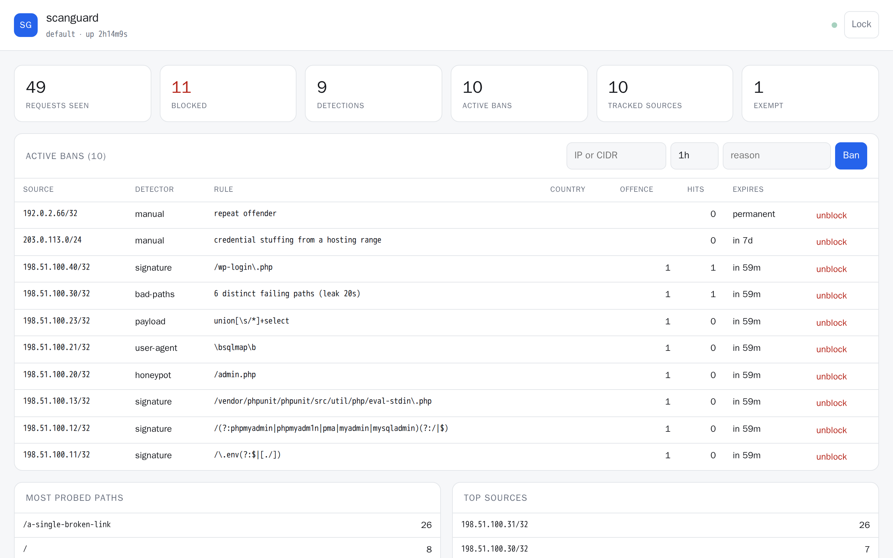
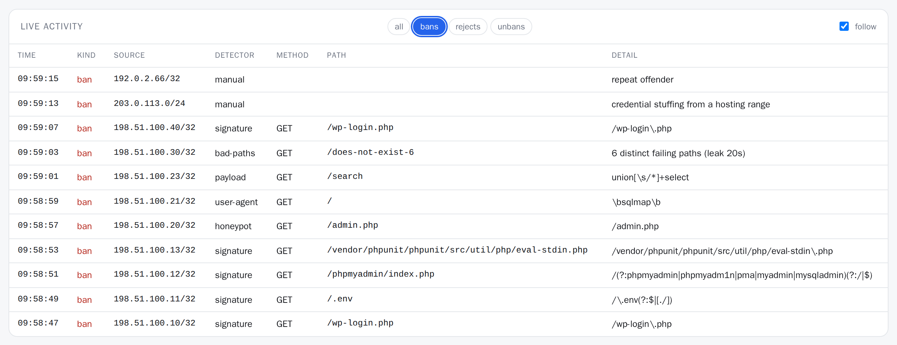
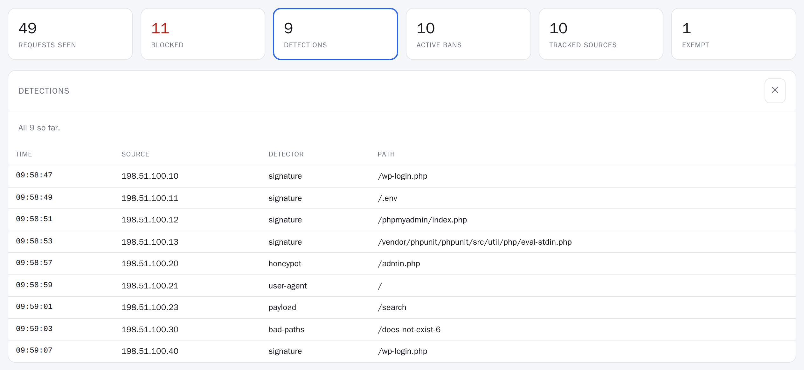
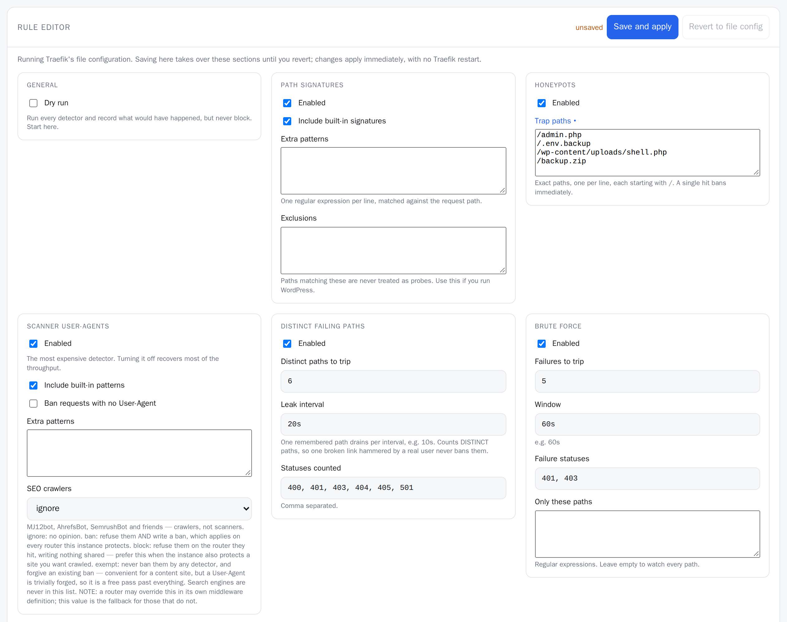

<div align="center">


# scanguard

**A Traefik middleware plugin that detects HTTP vulnerability scanning, bans the source, and ships its own web console.**

One artifact. No sidecar, no database, no agent. MIT.



**Status:** [v0.2.0](https://github.com/phoen-ix/scanguard/releases/tag/v0.2.0), tested against Traefik v3.7.17.

</div>

---

Every public host gets the same background noise: `/wp-login.php`, `/.env`,
`/phpmyadmin`, `/.git/config`, endless 404s from someone else's wordlist.
scanguard watches for it, blocks the source before your backend is touched, and
gives you a page where you can see who is banned and let them back in.

```yaml
# The whole installation.
experimental:
  plugins:
    scanguard:
      moduleName: github.com/phoen-ix/scanguard
      version: v0.2.0
```

**Contents:** [What it does](#what-it-does) · [The console](#the-console) · [Honest comparison](#honest-comparison) · [Install](#install) · [⚠️ Client IP](#-client-ip-or-how-to-take-your-own-site-down) · [⚠️ WebSockets, SSE and gRPC](#-websockets-sse-and-grpc) · [Firewall](#blocking-at-the-firewall) · [Configuration](#configuration) · [Development](#development) · [Performance](#performance) · [Limitations](#limitations) · [Documentation](#documentation)

## What it does

| | |
|---|---|
| **Signature probes** | 87 curated paths that only a scanner asks for. Blocked before the request reaches your backend. |
| **Distinct-404 floods** | A leaky bucket over *distinct* failing paths — so a scanner walking a wordlist is caught, and a real user hammering one broken link never is. |
| **Honeypots** | Paths you invent that no legitimate client could know. One hit, instant ban, effectively zero false positives. |
| **Scanner user-agents** | nikto, sqlmap, nuclei, masscan, zgrab and friends. Generic clients like `curl` and `python-requests` are deliberately *not* in the defaults. |
| **User-agent rotation** | Opt-in (`detectors.uaRotation`): a leaky bucket over the *distinct* user-agents of one source. In 15 days of production traffic 133 banned scanners used six or more within 60s; real Googlebot peaked at five. Risk: many real users behind one address (CGNAT, corporate NAT, a shared IPv6 /64). |
| **SEO crawlers** | MJ12bot, AhrefsBot, SemrushBot and friends, as their own opt-in switch, since they are not scanners: `detectors.userAgent.crawlers` is `ignore` (default), `ban`, `block` or `exempt`. Search engines are never on the list. **The one setting that can differ per router** — see [Crawlers, per router](#crawlers-per-router). |
| **Brute force** | Repeated 401/403 from your real login endpoints. |
| **Rate abuse** | Token bucket per source, independent of status code. |
| **Injection payloads** | SQLi, traversal, template injection and XSS probes in the query string and optionally the body. Checked in both raw and decoded form. |

Every detector is individually switchable, and every threshold is configurable.

- **Escalating bans:** `1h → 24h → 7d → permanent`, dropping a rung when a source behaves.
- **Persistent:** bans survive a Traefik restart.
- **Notifications:** a webhook, Discord/Slack/ntfy/Gotify, or AbuseIPDB.

### Range escalation (opt-in)

`enforcement.subnet` bans a whole range once enough of its addresses have been banned.

- **Why:** research scanners walk whole ranges, so every address arrives as a fresh
  first offence and the ladder never engages. One deployment banned 205 distinct
  addresses in a single /24 in 15 days, every one at rung 1.
- **How:** the fifth source banned inside one /24 (IPv6: /48) within 24h bans the
  whole range, which then climbs one ladder of its own.
- **Replayed over those 15 days**, it would have stopped 316 backend probes and
  saved 1146 ban entries. The collateral was 21 addresses never banned
  themselves, almost all other scanners and Tor exits.
- **The risk:** a range ban also hits innocent neighbours — Tor exits, shared
  hosting, CGNAT.
- **Guards:** a range that overlaps the allowlist or `trustedProxies` is never
  banned (refused, and logged once). Only automatic bans count towards one:
  manual bans and crawler `block` do not.

## The console

<div align="center"><em>Your own router, on your own host or port — not a tab in the Traefik dashboard.</em></div>

- **Bans:** the active list with the rule that caught each, one-click unblock, and
  manual ban by IP or CIDR.
- **Traffic:** a live activity feed, most-probed paths and top sources.
- **Rules:** a **full rule editor** (below).
- **Self-contained:** one page, no build step, no npm, no CDN.







Every screen, with a sentence on each: [docs/screenshots](docs/screenshots/README.md).

### Editing rules from the browser

Every detector, threshold, allowlist and enforcement setting can be changed in the
console and takes effect on the **next request** — no Traefik restart, no reload,
no file to edit.

Traefik's configuration is one-way: it is decoded once when the middleware is
built, and nothing can write back to it. Writing to the file provider instead
would be worse: every write trips fsnotify, rebuilds the whole router tree and
re-runs `New()` for every plugin middleware on every router.

So scanguard keeps its own override store, saved beside the ban list and restored
at startup.

- **Only what you change is taken over.** Edit a honeypot and the console owns
  `detectors`; `enforcement` keeps tracking your YAML. The editor marks changed
  fields and lists exactly which sections it manages.
- **Edits are validated by the same parser as the file.** A broken regex comes
  back as a 422 with the reason and the running rules are untouched — it cannot
  half-apply and leave you undefended.
- **Reverting restores the file configuration**, section by section.
- **A Traefik reload re-layers your edits** onto the new file config rather than
  discarding them.
- **`clientIP`, `store`, `admin` and `notify` are not editable.** They hold
  secrets, or must agree with Traefik's *static* configuration that nothing at
  runtime can change — see the comment at the top of `overrides.go`.
- **Replicas:** with the Redis backend, a rule change on one replica reaches the
  others on their next refresh, exactly like a ban.

### Why not a dashboard tab

**Traefik plugins cannot extend the Traefik dashboard.** The dashboard is a
compiled-in single-page app with no extension point
([traefik#8684](https://github.com/traefik/traefik/issues/8684), open since
January 2022), and its own CSP blocks embedding a plugin page in an iframe.

So scanguard serves its console on a router you define. Put it on a private
entrypoint and chain your own auth in front of it.

## Honest comparison

**If your actual problem is "my server is getting hammered and I want it to
stop", deploy [CrowdSec](https://www.crowdsec.net/) instead.** CrowdSec plus
`crowdsec-bouncer-traefik-plugin` plus the community web UI covers most of what
this does, with community-sourced threat intelligence, a real decisions database,
and proper multi-node support. It is free, self-hostable, and more battle-tested
than anything one person writes in a month.

scanguard exists for the case CrowdSec does not serve: **one lightweight artifact
you drop into Traefik, with a console built in.** No agent container, no access
log plumbing, no hub. If that is what you want, this is for you.

| | scanguard | CrowdSec + bouncer | tomMoulard/fail2ban |
|---|---|---|---|
| Artifacts to deploy | 1 | 3+ | 1 |
| Built-in web console | ✅ | separate UI | ❌ ([#238](https://github.com/tomMoulard/fail2ban/issues/238)) |
| Survives restart | ✅ | ✅ | ❌ |
| Multiple Traefik replicas | Redis backend | ✅ | ❌ |
| Community threat intel | ❌ | ✅ | ❌ |
| Bounded memory | ✅ | ✅ | ❌ (no eviction) |
| Trusted-proxy validation | ✅ | ✅ | ❌ (spoofable) |

## Install

### Local plugin (recommended to start)

```yaml
# traefik static configuration
experimental:
  localPlugins:
    scanguard:
      moduleName: github.com/phoen-ix/scanguard
```

```yaml
# docker-compose.yml
volumes:
  - ./scanguard:/plugins-local/src/github.com/phoen-ix/scanguard:ro
  - scanguard-state:/var/lib/scanguard
```

Local plugins need no network access at startup. That matters more than it
sounds: a remote plugin is fetched from `plugins.traefik.io` on **every** Traefik
start, and one transient failure disables *every* declared plugin with a
misleading error ([traefik#13005](https://github.com/traefik/traefik/issues/13005)).
For something whose job is security, prefer a local plugin or a baked image.

### Attach it

Three options, and they compose:

```yaml
# 1. EntryPoint-wide — every router, automatically. Static config, needs a restart to change.
entryPoints:
  websecure:
    http:
      middlewares:
        - scanguard@file

# 2. Per-router — gradual rollout, per-route tuning. Easy to forget a router.
labels:
  - "traefik.http.routers.myapp.middlewares=scanguard@file"

# 3. Catch-all — the ONLY way to see probes aimed at hostnames you do not serve.
#    Traefik answers those 404 from the router itself; no middleware ever runs.
http:
  routers:
    catchall:
      rule: HostRegexp(`^.+$`)
      priority: 1
      service: your-dummy-service
      middlewares: [scanguard]
```

### Crawlers, per router

`detectors.userAgent.crawlers` is read from the middleware definition that handled
the request, not from the instance. So placeholder hosts can refuse crawlers while
a real site on the same instance, ban list and console welcomes them.

**Prefer `block` to `ban` when the instance also protects a site you want
crawled:**

- `ignore` (default): the crawler list is unused.
- `ban`: writes a ban record, so the crawler is refused on **every** router this
  instance protects, and escalates.
- `block`: refuses the crawler on **this router only**, with `rejectStatus`. No ban
  record, no offence, no escalation.
- `exempt`: the crawler skips every detector **and** an existing ban. A
  User-Agent is trivially forged, so anyone copying the string gets the same pass.

The example config, the trap `block` exists to avoid and the rules for sibling
definitions: [docs/crawlers.md](docs/crawlers.md).

### Turn on the console

```yaml
http:
  routers:
    scanguard-console:
      rule: PathPrefix(`/`)
      entryPoints: [admin]          # bind this entrypoint to 127.0.0.1 in production
      service: your-dummy-service   # never reached; the middleware terminates
      middlewares: [your-basic-auth, scanguard-ui]   # auth first: scanguard-ui never calls the next one

  middlewares:
    scanguard-ui:
      plugin:
        scanguard:
          instanceName: default     # must match your detector instance
          uiMode: true
          admin:
            enabled: true
            token: "a-long-random-secret"
```

A `uiMode` instance is a *view* onto the shared runtime, not a second
configuration of it — it contributes only the admin surface and cannot overwrite
your detectors.

## ⚠️ Client IP, or how to take your own site down

If Traefik sits behind Cloudflare, a load balancer, or a Kubernetes Service,
`RemoteAddr` is **the proxy**, not the client. Ban it and every legitimate user is
locked out at once. Both halves of the configuration are required:

```yaml
# 1. Traefik must be told to keep the headers. Without this it DELETES every
#    X-Forwarded-* header before any middleware runs, and scanguard silently
#    bans nobody at all.
entryPoints:
  websecure:
    forwardedHeaders:
      trustedIPs: ["173.245.48.0/20", "..."]   # cloudflare.com/ips-v4

# 2. scanguard must be told which peers may be believed.
clientIP:
  trustedProxies: ["173.245.48.0/20", "..."]   # the same list
  header: Cf-Connecting-Ip
```

`trustedProxies` has **no default**, on purpose. A configurable client-IP header
without a trusted-proxy check is not a hardening gap, it is a remote "ban anybody
you name" primitive — an attacker sets the header per request to evade their own
ban and to poison your list with third parties. So scanguard:

- refuses to start if you set `clientIP.header` without `clientIP.trustedProxies`
- never bans an address inside `trustedProxies`
- refuses to attribute a request it cannot identify

Cloudflare edge addresses do get banned where nothing sits behind Cloudflare:
15 of them in 15 days on one deployment (51 requests), Workers used as scanner
egress. That is correct there; behind Cloudflare it is the outage above, which
`trustedProxies` plus `header` prevents.

If your load balancer speaks PROXY protocol, use it instead — it actually
rewrites `RemoteAddr` and the whole problem disappears.

**Roll out with `dryRun: true` first.** It runs every detector, logs and displays
everything it *would* have banned, and blocks nothing.

## ⚠️ WebSockets, SSE and gRPC

Seeing response codes means wrapping `http.ResponseWriter`. A wrapper that drops
`http.Flusher` and `http.Hijacker` silently breaks streaming on every route it
touches — [traefik#10269](https://github.com/traefik/traefik/issues/10269) — and
it surfaces weeks later as "the chat stopped working", never as an error.

scanguard forwards `Flush`, `Hijack`, `ReadFrom` and `Push`, skips wrapping
protocol-upgrade requests entirely, and does not wrap at all when no
response-status detector is enabled. `examples/streaming-check.sh` is the release
gate, and it passes against Traefik v3.7.17. **Re-run it after every Traefik
upgrade** — and if you ever see a `flusher-unavailable` warning in the log, set
`observeResponse: false` on that route.

## Blocking at the firewall

scanguard cannot touch nftables itself: there is no `os/exec` under Yaegi, and
Traefik has no privileges to do it with. It emits a ban event instead, and **you
supply the helper**: a small privileged container that consumes the webhooks and
applies nftables rules. No such helper ships here.

```yaml
notify:
  webhooks:
    - url: http://scanguard-nft:8080/ban
      events: [ban, unban]
```

- **Payload contract**, verified end to end by `examples/notify-check.sh`:
  [docs/webhooks.md](docs/webhooks.md).
- **Range bans** carry a CIDR `key` and no `client`, so they are never reported to
  AbuseIPDB.
- **Only `ban` and `unban` are delivered**, bounded and fire-and-forget: a
  hammering scanner cannot flood your endpoint, and a dead endpoint cannot stall
  Traefik.

## Configuration

<details>
<summary><b>Full reference</b></summary>

```yaml
enabled: true
instanceName: default        # keys the shared state; instances sharing a name share bans
dryRun: false                # detect and log, never block
observeResponse: true        # wrap ResponseWriter; needed by badPaths and bruteForce
uiMode: false                # serve only the console on this router (see "Turn on the console")

store:
  backend: memory            # memory | file | redis
  path: /var/lib/scanguard/state.json
  snapshotInterval: 30s      # also the janitor period: expiry sweeps and the Redis refresh run on it (30s minimum)
  failOpen: true
  maxEntries: 50000          # hard cap on tracked sources (LRU) and on bans (soonest-expiring go first)
  redis:
    address: ""              # required for the redis backend, e.g. redis:6379
    password: ""
    db: 0
    keyPrefix: "scanguard:"
    timeout: 2s

clientIP:
  trustedProxies: []         # NO DEFAULT — see the warning above
  header: ""                 # e.g. Cf-Connecting-Ip; only honoured from a trusted peer
  ipv4Prefix: 32             # ban-key width
  ipv6Prefix: 64             # /128 bans are useless; a host owns a whole /64

allowlist:
  cidrs: []                  # office egress, uptime monitors
  userAgents: []             # matched against the User-Agent header — see docs/crawlers.md on forged UAs
  paths: []                  # e.g. ^/health$

detectors:
  signatures:  { enabled: true,  useDefaults: true, patterns: [], exclude: [] }
  honeypots:   { enabled: true,  paths: [] }
  userAgent:   { enabled: true,  useDefaults: true, patterns: [], banEmptyUA: false,
                 crawlers: ignore }   # ignore | ban | block | exempt — settable per router
  badPaths:    { enabled: true,  capacity: 20, leak: 10s, statuses: [400,401,403,404,405,501] }
  bruteForce:  { enabled: false, capacity: 5, window: 60s, statuses: [401,403], paths: [] }
  rateAbuse:   { enabled: false, rps: 50, burst: 100 }
  uaRotation:  { enabled: false, capacity: 8, leak: 60s }   # distinct user-agents per source; capacity 2-128, leak > 0
  payload:     { enabled: false, useDefaults: true, scanQuery: true, scanBody: false, maxBodyBytes: 8192 }

enforcement:
  rejectStatus: 403          # 404 hides the middleware's existence
  rejectBody: ""
  escalation: ["1h", "24h", "168h", "0"]   # "0" means permanent
  decay: 24h                 # behave this long and drop a rung
  tarpit: { enabled: false, delay: 3s, maxConcurrent: 50 }   # maxConcurrent: at most 10000
  subnet:                    # range escalation — see "Range escalation"
    enabled: false
    threshold: 5             # this many banned sources in one range ...
    window: 24h              # ... within this long bans the range; "0"/permanent refused
    ipv4Prefix: 24           # the range width, 8 up to clientIP.ipv4Prefix - 1
    ipv6Prefix: 48           # 16 up to clientIP.ipv6Prefix - 1
                             # widths and threshold (2 or more) are checked only when enabled

notify:
  timeout: 5s
  webhooks: [{ url: "", method: POST, headers: {}, events: [ban, unban] }]
  chat: { kind: "", url: "", events: [] }   # discord | slack | ntfy | gotify
  abuseipdb: { enabled: false, apiKey: "", report: true, check: false, minConfidence: 75, cacheTTL: 24h }

geo: { enabled: false, provider: ip-api, cacheTTL: 168h }   # console display only

admin:
  enabled: false             # off by default; no default token
  pathPrefix: /__scanguard
  token: ""                  # 16+ characters, compared in constant time
  trustForwardedUser: false  # honour X-Forwarded-User from Authelia/Authentik/oauth2-proxy — see the note below
  readOnly: false
  eventLogSize: 500
  serveOnDetectionRoutes: false   # also answer pathPrefix on every route the detector protects; leave it off
```

Locked out of the console? `SCANGUARD_DISABLE=1` in Traefik's environment turns
scanguard into a pass-through at startup, no config edit required.

**On `trustForwardedUser`.** When it is on, any request carrying an
`X-Forwarded-User` header is an authenticated administrator and the token is not
checked.

- scanguard cannot tell a header your auth proxy set from one the client sent:
  by the time a middleware runs, the peer is the client, not the proxy.
- Turn it on only when the auth middleware in front of the console overwrites
  that header on every request. With Traefik's `forwardAuth`, list it in
  `authResponseHeaders`, which deletes the client's copy before setting the
  proxy's.
- Never turn it on for a router that skips that middleware. scanguard logs a
  warning at startup to say the same.
- Failed console logins are counted in `stats.authFailures` and logged at most
  once a minute.

</details>

<details>
<summary><b>Running WordPress?</b></summary>

The default signatures include the `wp-*` paths, so your own admin traffic would
ban you. Either allowlist yourself, or exclude them:

```yaml
detectors:
  signatures:
    exclude: ['^/wp-admin/', '^/wp-login\.php$', '^/wp-includes/', '^/wp-content/']
```

</details>

## Development

```bash
go test ./...                                  # unit tests
# Run the plugin under the real interpreter. Yaegi loads it from a GOPATH tree
# at its import path (default /go), so give it one:
gp=$(mktemp -d); mkdir -p "$gp/src/github.com/phoen-ix"; ln -s "$PWD" "$gp/src/github.com/phoen-ix/scanguard"
(cd tools/yaegi-smoke && SMOKE_GOPATH="$gp" go run .)
cd examples && docker compose up -d
./scanner-sim.sh                               # end-to-end detection checks against live Traefik
./streaming-check.sh                           # the WebSocket + SSE release gate
./rules-check.sh                               # the rule editor, including restart survival
./notify-check.sh                              # webhooks and chat, delivered for real
```

**`tools/yaegi-smoke` is the most important thing in this repository.** Traefik
interprets plugins with [Yaegi](https://github.com/traefik/yaegi) v0.16.1, which
exposes only the Go 1.22 standard library, so whole classes of bug are invisible
to `go build` and `go test`. The traps, and what the smoke test asserts:
[docs/development.md](docs/development.md).

### E2E

`e2e/tests/` is a Playwright suite of the console;
[e2e/COVERAGE.md](e2e/COVERAGE.md) maps each feature to its test.

- **Covers** every panel, form, tile and rule-editor group, as a guest, an
  operator, a read-only operator and an SSO user, plus two Traefik replicas
  sharing the Redis backend.
- **`scripts/e2e.sh`** starts the examples harness with its overlay
  `examples/docker-compose.e2e.yml` as compose project `scanguard_e2e` (the
  fixed ports plus 8801/9901 and 8802/9902), runs the suite, and removes the
  harness again.
- **CI** runs it as the `console e2e` job.

```bash
(cd e2e && npm ci && npx playwright install chromium)
scripts/e2e.sh                                 # or e.g. scripts/e2e.sh tests/bans.spec.ts
```

### Screenshots

The images in this README and in [docs/screenshots](docs/screenshots/README.md)
come from a Playwright tour of the console (`e2e/docs/tour.spec.ts`), which
`scripts/docs-screenshots.sh` runs against the examples harness: once on the
empty console, once after `scanner-sim.sh` has produced bans. It uses the
harness's fixed ports, so stop any other harness first.

```bash
(cd e2e && npm ci && npx playwright install chromium)
scripts/docs-screenshots.sh                    # rewrites docs/screenshots/*.png
```

CI runs the same tour as a render check after `scanner-sim.sh`; the manual
"Docs screenshots" workflow returns the PNGs as an artifact.

## Performance

Roughly a third of the raw proxy throughput (2760 vs 8790 req/s, measured on
Traefik v3.7.10): the price of an interpreted plugin, and still five to ten times
a "hundreds of requests per second" workload.

- **Already-banned request:** 770 ns.
- **Dominant cost:** user-agent matching; turning that detector off buys most of
  the throughput back.

Benchmarks and why there is no literal pre-filter: [docs/performance.md](docs/performance.md).

## Limitations

- **No Traefik dashboard tab.** Not now, not later. See [above](#why-not-a-dashboard-tab).
- **Single Traefik instance by default.** State is process-global, so N replicas
  means N independent ban lists, thresholds effectively multiplied by N, and an
  Unblock that applies to one replica. It degrades *silently*.
  - **Use the Redis backend for HA:** bans are shared and propagate to other
    replicas within one janitor cycle (~30s, measured), the way CrowdSec's
    stream mode works.
  - **Per-source counters stay local by design:** shipping a counter increment to
    Redis on every request would put a network round trip on the hot path to
    share state nobody needs.
  - **A Redis outage** therefore degrades to per-replica enforcement rather than
    to an outage of its own.
- **Range escalation counts per replica.** The sources banned inside a range are
  tallied in the process-local counters, so with several replicas one of them has
  to reach the threshold. The range ban itself is then shared like any other.
- **Plugins load only at startup.** Installing or upgrading scanguard needs a
  Traefik restart. The console cannot do it.
- **Response-status detectors act one request late.** The decision for request N
  can only be enforced from N+1. That is inherent to observing responses.
- **Yaegi plugins have broken on Traefik patch releases.** Pin your Traefik
  version and re-run the harness after upgrades.
- **Interpreted code is unprofilable** — every frame shows as
  `yaegi/interp.call.func9` in pprof. The hot path is kept to a map lookup and one
  pre-compiled alternation regexp for that reason.

## Documentation

- [docs/screenshots](docs/screenshots/README.md) — every console screen, with a sentence each
- [docs/crawlers.md](docs/crawlers.md) — the per-router crawler policy in full
- [docs/webhooks.md](docs/webhooks.md) — the ban webhook payload and its delivery
- [docs/performance.md](docs/performance.md) — throughput and per-request benchmarks
- [docs/development.md](docs/development.md) — the Yaegi interpreter traps
- [e2e/COVERAGE.md](e2e/COVERAGE.md) — every feature and the test that covers it

## Licence

MIT. Default rulesets were written for this project; the design owes a debt to
[tomMoulard/fail2ban](https://github.com/tomMoulard/fail2ban) (MIT),
[CrowdSec](https://github.com/crowdsecurity/crowdsec) (MIT) — whose distinct-path
bucket model is the single best idea here — and
[maxlerebourg/crowdsec-bouncer-traefik-plugin](https://github.com/maxlerebourg/crowdsec-bouncer-traefik-plugin)
(Apache-2.0), which proved most of these mechanisms work under Yaegi at all.
