# The console, screen by screen

Every state of the scanguard console, taken by the docs tour
(`e2e/docs/tour.spec.ts`) against the [examples harness](../../examples/) after
`scanner-sim.sh` has run. Regenerate with `scripts/docs-screenshots.sh`
(README, "Screenshots"). Addresses are documentation ranges (RFC 5737).

## Access gate

The console asks for the `admin.token` before it shows anything; the token is
sent as the `X-Scanguard-Token` header and kept in the tab's session storage.

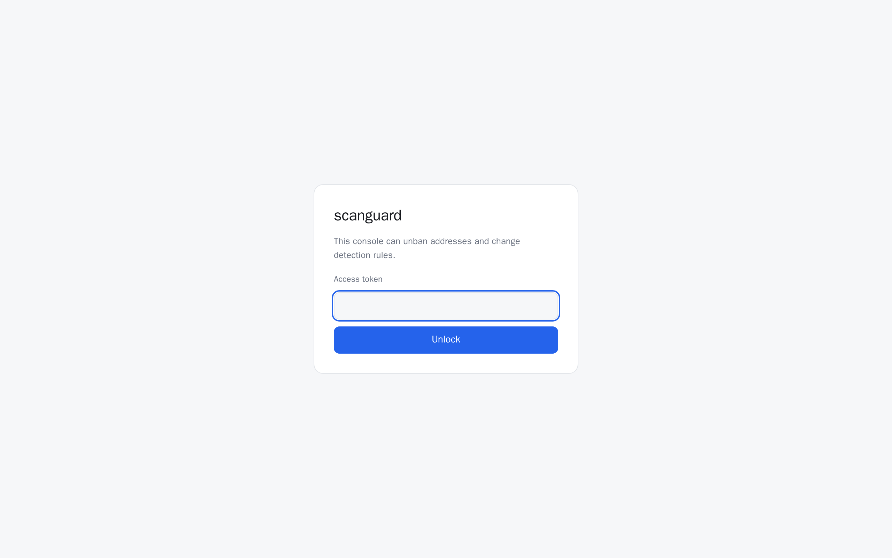

## Overview

Counters across the top, then every active ban: the source, the detector and
rule that caught it, offence count, hits since the ban, and when it expires.
The form above the table bans an address or CIDR by hand.

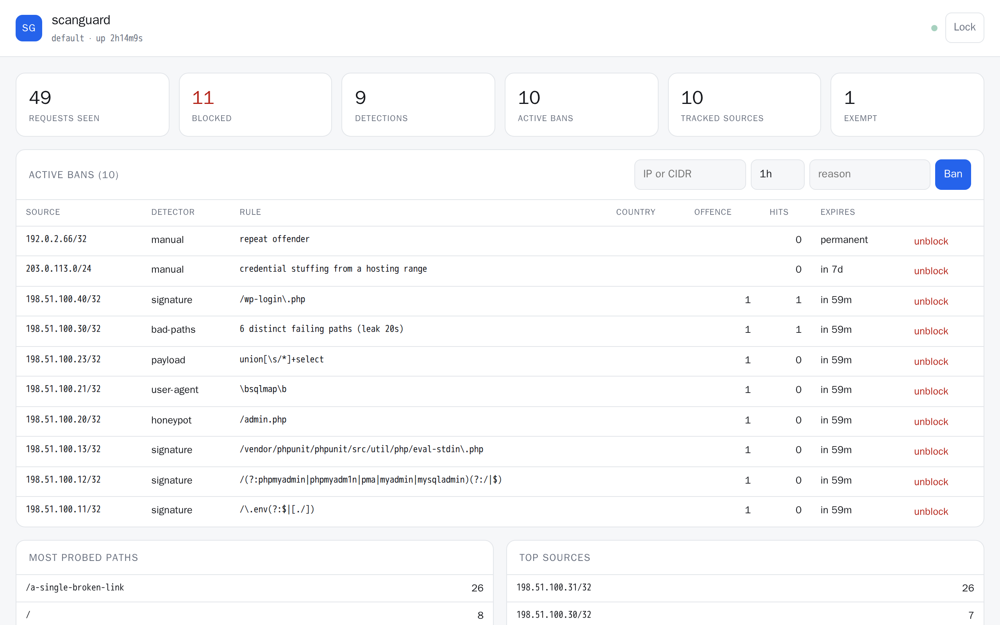

The same page in a dark colour scheme (it follows the browser's), and the top
of it on a phone, where the tiles and the ban form stack (the ban table scrolls
sideways there and reads better on a wider screen):

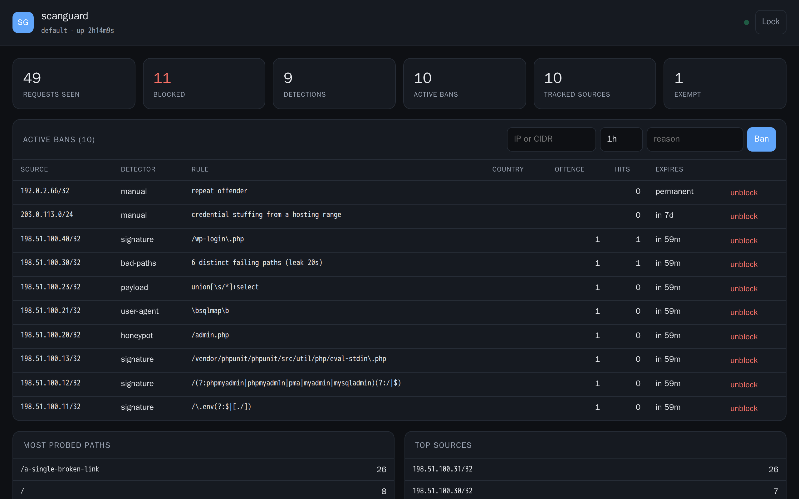

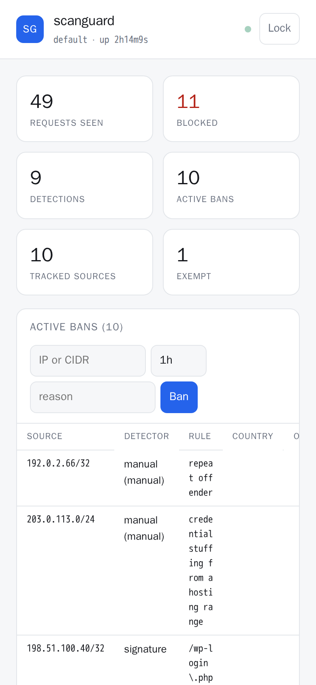

## Empty console

A fresh instance before anything has been probed.

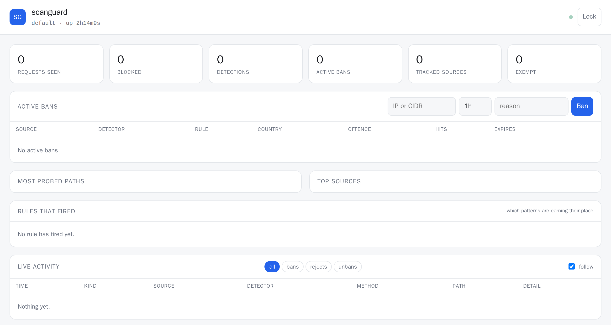

## Counter drill-down

Each counter opens the records behind it; here, every detection the event log
holds (manual bans are not detections, so they are not listed).

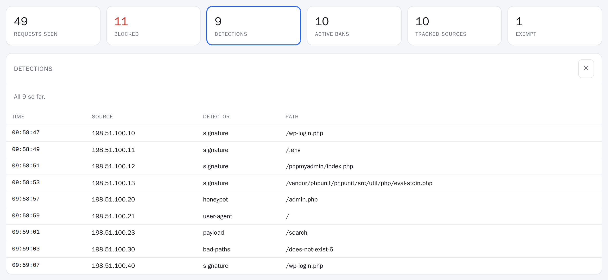

## Live activity

The event feed, polled every three seconds, filtered here to bans: which rule
fired, on which path, and for how long the source is banned.

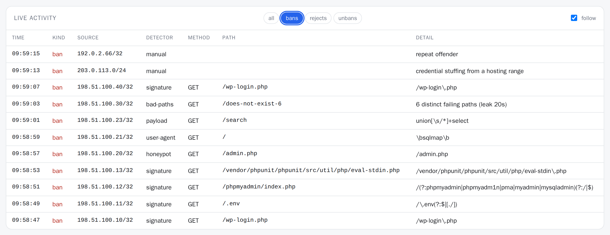

## Most probed paths, top sources, rules that fired

What scanners ask for, who asks most, and which patterns are earning their
place. Each list scrolls inside its panel.

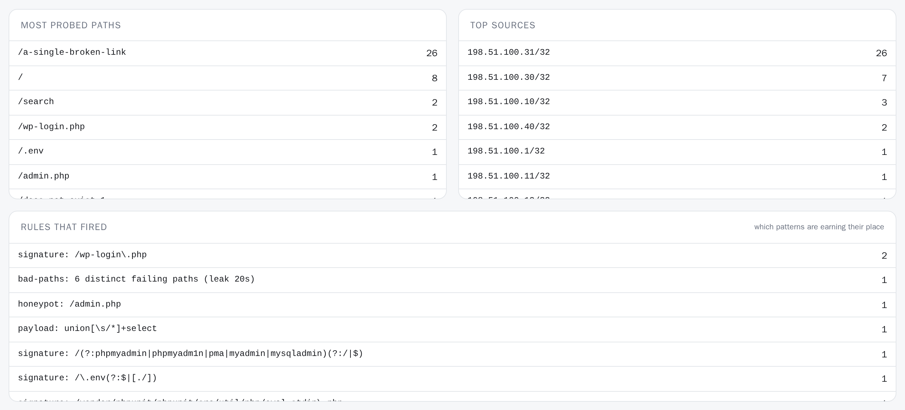

## Detectors and compiled ruleset

Which detectors are on (with their hit counts), the running configuration, and
every pattern currently compiled in (a scrolling list).

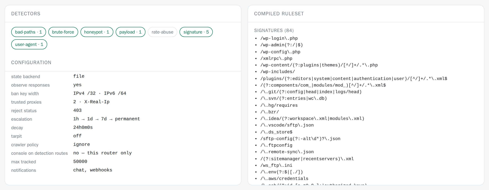

## Rule editor

Every detector, threshold, allowlist and enforcement setting, applied on the
next request without a Traefik restart. A changed field is marked and the
editor says the change is unsaved. (The first two rows of groups; rate,
payload, allowlist and enforcement follow below.)

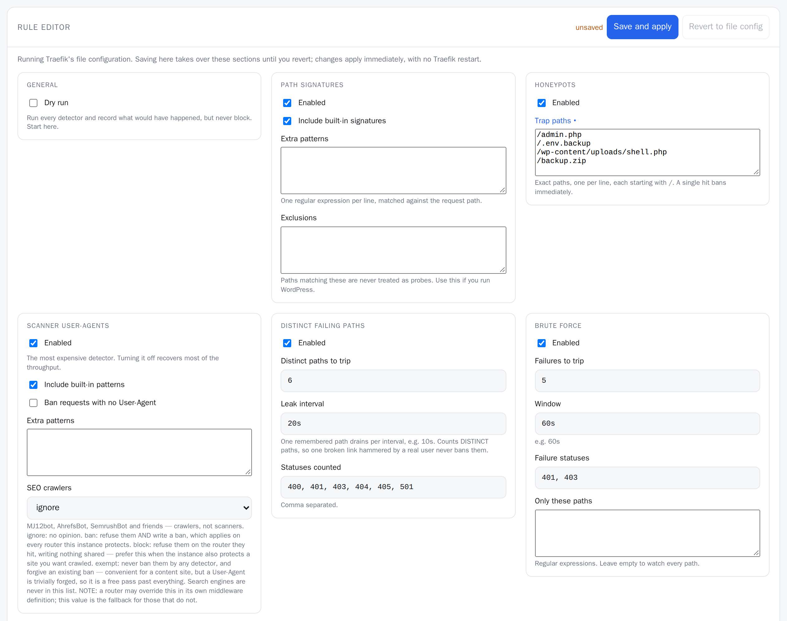

An invalid edit — here a broken regular expression — comes back as a 422 with
the parser's reason, and the running rules stay as they were.

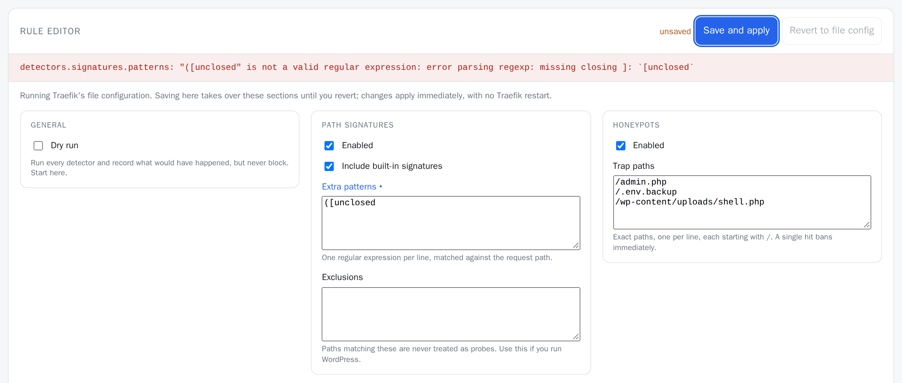
